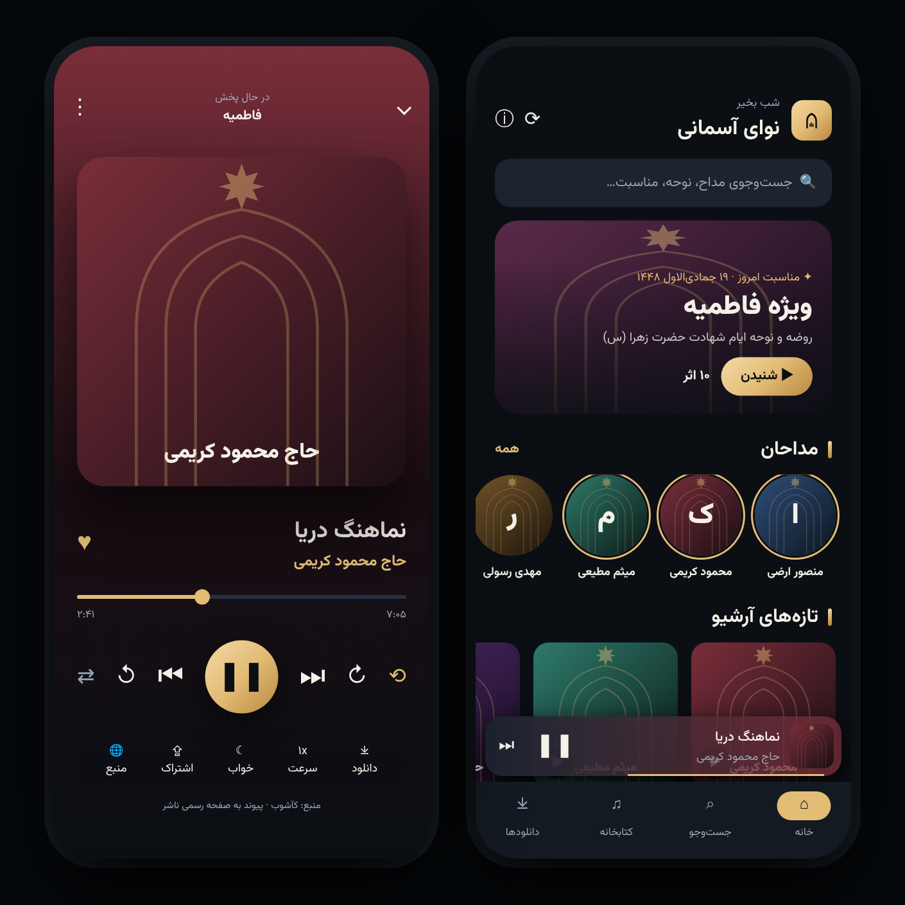

<div dir="rtl">

# نوای آسمانی | Nava Asemani

**«هر نوا، راهی به نور»** — آرشیو زنده مداحی مداحان معروف ایران، با پخش آنلاین، دانلود برای شنیدن بدون اینترنت، و دسترسی مستقیم به سایت و کانال‌های رسمی هر مداح.

</div>



<div dir="rtl">

## امکانات

- **ظاهر به سبک اپ‌های موسیقی** (مثل ملودیفای): تم تیره، طلای محراب، قلم وزیرمتن، کاورهای رنگی اختصاصی هر مداح، مینی‌پلیر شناور و پخش‌کننده تمام‌صفحه.
- **خانه**: «مناسبت امروز» که خودکار از تقویم قمری انتخاب می‌شود (فاطمیه، محرم، اربعین، …)، ردیف مداحان، تازه‌ها، ادامه شنیدن، پرشنیده‌ها و دسته‌ها.
- **صفحه هر مداح**: همه آثار، پخش همه/تصادفی، دنبال‌کردن، و دکمه‌های سایت رسمی، اینستاگرام، تلگرام، یوتیوب، آپارات، ایتا و روبیکا.
- **پخش‌کننده**: پخش در پس‌زمینه با کنترل از اعلان و صفحه قفل، ۱۰ ثانیه جلو/عقب، تکرار، تصادفی، سرعت پخش، زمان‌سنج خواب، و ادامه از همان‌جا برای روضه‌ها و سخنرانی‌های طولانی.
- **دانلود**: ذخیره در پوشه `Music/NavaAsemani` با نمایش پیشرفت؛ فایل دانلودشده بدون اینترنت پخش می‌شود.
- **کتابخانه**: علاقه‌مندی‌ها، فهرست‌های پخش، مداحان دنبال‌شده و تاریخچه.
- **جست‌وجوی هوشمند فارسی**: ی/ک عربی، نیم‌فاصله و ارقام فارسی را یکسان می‌گیرد؛ فیلتر دسته و مناسبت.
- **آرشیو زنده**: فهرست آثار از پوشه `catalog/` همین مخزن خوانده می‌شود. هر بار که آن را ویرایش کنید، اپ‌های نصب‌شده بدون به‌روزرسانی، فهرست تازه را می‌گیرند. یک ربات هم هر ۶ ساعت فیدهای رسمی مداحان را می‌خواند و آثار تازه را خودکار اضافه می‌کند.
- **ساخت خودکار APK** با GitHub Actions و انتشار در بخش Releases.

## حقوق صاحبان اثر

این اپ هیچ فایل صوتی را بازنشر یا کپی نمی‌کند. پخش و دانلود فقط از **لینک مستقیمی** انجام می‌شود که خود مداح یا ناشر رسمی منتشر کرده است. برای آثاری که لینک مستقیم ندارند (مثلاً اینستاگرام یا یوتیوب)، صفحه رسمی همان ناشر باز می‌شود. گزینه دانلود را فقط برای منابعی روشن کنید که خودشان اجازه دانلود داده‌اند (یا از دفتر مداح مجوز گرفته‌اید).

---

## راهنمای کامل: گذاشتن روی گیت‌هاب و گرفتن APK

### گام ۱ — ساخت حساب و مخزن
1. در https://github.com ثبت‌نام کنید (اگر حساب ندارید).
2. بالا سمت راست روی **+** و بعد **New repository** بزنید.
3. **Repository name** را `nava-asemani` بگذارید.
4. گزینه **Public** را انتخاب کنید (لازم است تا اپ بتواند فهرست آثار را از مخزن بخواند؛ ساخت APK هم برای مخزن عمومی رایگان و نامحدود است).
5. هیچ تیکی برای README یا .gitignore نزنید و **Create repository** را بزنید.

### گام ۲ — بارگذاری فایل‌ها (ساده‌ترین روش: GitHub Desktop)
1. برنامه **GitHub Desktop** را از https://desktop.github.com نصب کنید و با حساب گیت‌هاب وارد شوید.
2. فایل ZIP پروژه را در یک پوشه باز (Extract) کنید. پوشه‌ای که داخلش `README.md` و `app` و `catalog` هست، پوشه اصلی است.
3. در GitHub Desktop: **File → Add local repository** و همان پوشه را انتخاب کنید. اگر پرسید «create a repository»، روی آن بزنید (نام: `nava-asemani`).
4. پایین سمت چپ در کادر **Summary** بنویسید `نسخه اول` و **Commit to main** را بزنید.
5. بالا **Publish repository** را بزنید، تیک **Keep this code private** را **بردارید** و Publish کنید.

> روش جایگزین با خط فرمان (Git Bash)، داخل پوشه پروژه:
> ```bash
> git init
> git add .
> git commit -m "نسخه اول"
> git branch -M main
> git remote add origin https://github.com/USERNAME/nava-asemani.git
> git push -u origin main
> ```
> به‌جای `USERNAME` نام کاربری خودتان را بگذارید.

> ⚠️ اگر از صفحه وب گیت‌هاب (Upload files) استفاده می‌کنید، مطمئن شوید پوشه مخفی `.github` هم بارگذاری شده باشد؛ بدون آن APK ساخته نمی‌شود. به همین دلیل GitHub Desktop توصیه می‌شود.

### گام ۳ — ساخته‌شدن خودکار APK
1. در صفحه مخزن، زبانه **Actions** را باز کنید. اگر دکمه سبز «I understand my workflows, go ahead and enable them» دیدید، بزنید.
2. کار **«ساخت اپ اندروید (APK)»** خودکار شروع می‌شود (حدود ۵ تا ۱۰ دقیقه). اگر شروع نشد: آن را از فهرست سمت چپ انتخاب کنید ← **Run workflow**.
3. وقتی تیک سبز ✅ خورد، به صفحه اصلی مخزن برگردید. در ستون سمت راست، بخش **Releases** را باز کنید.
4. در آخرین نسخه، از بخش **Assets** فایل `NavaAsemani-1.0.X.apk` را دانلود کنید.

### گام ۴ — نصب روی گوشی
1. فایل APK را روی گوشی اندروید (نسخه ۱۰ به بالا) بفرستید و بازش کنید.
2. اگر پیام «نصب از منابع ناشناس» آمد، برای همان برنامه (مثلاً فایل‌منیجر یا تلگرام) اجازه بدهید.
3. نسخه‌های بعدی را مستقیم روی همین نسخه نصب کنید. همه نسخه‌ها با یک امضا ساخته می‌شوند، پس علاقه‌مندی‌ها و دانلودها پاک نمی‌شوند.

### اگر ساخت قرمز ❌ شد
روی اجرای قرمز در Actions بزنید ← مرحله‌ای که قرمز است را باز کنید ← چند خط آخر خطا را کپی کنید و برای پشتیبان فنی (یا Claude) بفرستید.
- اگر مرحله **«بررسی سلامت کاتالوگ»** قرمز شد، یعنی در `catalog/catalog.json` اشتباه تایپی هست؛ پیام خطا به فارسی می‌گوید کجا.
- اگر مرحله **«انتشار در Releases»** خطای دسترسی داد: Settings ← Actions ← General ← بخش Workflow permissions را روی **Read and write permissions** بگذارید و Save کنید.

---

## افزودن مداح و اثر (بدون برنامه‌نویسی)

همه محتوا در فایل `catalog/catalog.json` است. در گیت‌هاب روی فایل بزنید ← آیکن مداد ✏️ ← ویرایش ← **Commit changes**. تغییر چند دقیقه بعد در همه اپ‌ها دیده می‌شود (روی دکمه ⟳ خانه بزنید).

### افزودن مداح
داخل `"maddahs": [ ... ]` یک مورد اضافه کنید (بین موردها ویرگول بگذارید):

```json
{
  "id": "ali-example",
  "name": "علی نمونه",
  "honorific": "حاج",
  "bio": "مداح اهل‌بیت علیهم‌السلام",
  "city": "بشرویه",
  "photo": "https://نشانی-عکس-با-اجازه.jpg",
  "featured": true,
  "links": [
    { "type": "site", "url": "https://example.ir" },
    { "type": "instagram", "url": "https://instagram.com/example" },
    { "type": "telegram", "url": "https://t.me/example" },
    { "type": "aparat", "url": "https://www.aparat.com/example" },
    { "type": "eitaa", "url": "https://eitaa.com/example" }
  ]
}
```
- `id` فقط حروف انگلیسی کوچک و خط تیره، و یکتا.
- نوع‌های پیوند: `site`، `instagram`، `telegram`، `youtube`، `aparat`، `eitaa`، `rubika`، `bale`، `podcast`.
- همه نشانی‌ها باید با `https://` شروع شوند.

### افزودن اثر
داخل `"tracks": [ ... ]`:

```json
{
  "id": "ali-example-001",
  "maddahId": "ali-example",
  "title": "عنوان نوحه",
  "category": "نوحه",
  "occasion": "فاطمیه",
  "year": "1404",
  "duration": "7:05",
  "streamUrl": "https://سایت-رسمی/فایل.mp3",
  "downloadUrl": "",
  "sourceUrl": "https://سایت-رسمی/صفحه-اثر",
  "sourceName": "پایگاه رسمی علی نمونه",
  "license": "با اجازه دفتر مداح",
  "downloadAllowed": true,
  "featured": false,
  "popular": false,
  "addedAt": "2026-10-30"
}
```
- **`streamUrl`**: لینک مستقیم فایل صوتی (mp3/m4a/ogg). اگر خالی باشد، با زدن اثر صفحه `sourceUrl` باز می‌شود.
- **`downloadAllowed`**: فقط وقتی `true` که ناشر اجازه دانلود داده است.
- دسته‌ها: `مداحی`، `روضه`، `نوحه`، `سخنرانی`، `ادعیه`، `مناجات`، `قرآن` (دسته تازه هم خودکار اضافه می‌شود).
- مناسبت‌ها آزادند و مجموعه‌های خانه بر اساس آن ساخته می‌شوند: `فاطمیه`، `محرم`، `اربعین`، `امام زمان`، …

### مجموعه‌های صفحه خانه
در `"collections"` هر مجموعه با `occasion` یا `category` آثار مرتبط را جمع می‌کند و `colors` رنگ کارت آن است.

---

## آرشیو زنده خودکار (اتصال به منابع رسمی)

فایل `catalog/sources.json` فهرست فیدهای رسمی است. ربات **«آرشیو زنده»** در Actions هر ۶ ساعت آن‌ها را می‌خواند و آثار تازه را به `catalog.json` اضافه می‌کند.

```json
{
  "enabled": true,
  "maddahId": "meysam-motiee",
  "type": "rss",
  "url": "https://نشانی-فید-رسمی",
  "sourceName": "پایگاه رسمی میثم مطیعی",
  "category": "مداحی",
  "downloadAllowed": false,
  "license": "پخش با ذکر منبع"
}
```
چه فیدهایی کار می‌کند:
- **پادکست رسمی** مداح (Castbox، Apple Podcasts، سایت شخصی): لینک RSS آن. فایل صوتی دارد، پس اثر در خود اپ پخش می‌شود.
- **سایت وردپرسی** دفتر مداح: معمولاً `https://سایت/feed`.
- **کانال یوتیوب**: `https://www.youtube.com/feeds/videos.xml?channel_id=...`. اثر با کاور اضافه می‌شود و صفحه یوتیوب را باز می‌کند.
- برای اجرای فوری: Actions ← «آرشیو زنده» ← **Run workflow**.

اینستاگرام، تلگرام و ایتا فید عمومی ندارند و استخراج فایل از آن‌ها مجاز نیست؛ برای آن‌ها فقط دکمه کانال رسمی در صفحه مداح بگذارید.

---

## دسترسی از داخل ایران

اپ فهرست آثار را به ترتیب از `raw.githubusercontent.com` و بعد `cdn.jsdelivr.net` می‌گیرد. اگر هر دو در دسترس نباشند، آخرین نسخه ذخیره‌شده و نسخه داخل خود APK نمایش داده می‌شود. اگر سرور یا هاست ایرانی دارید، فایل `catalog/catalog.json` را آنجا هم بگذارید و نشانی‌اش را در GitHub (Settings ← Secrets and variables ← Actions ← **Variables**) با نام `NAVA_CATALOG_URL` ثبت کنید. از ساخت بعدی، اپ آن نشانی را هم امتحان می‌کند.

## کلید امضای اختصاصی (اختیاری، برای انتشار در بازار/مایکت)

نسخه‌های فعلی با کلید مشترک `app/nava-debug.keystore` امضا می‌شوند که برای نصب مستقیم کافی است. برای انتشار رسمی در فروشگاه‌ها یک کلید اختصاصی بسازید:
```bash
keytool -genkeypair -v -keystore nava-release.jks -alias nava -keyalg RSA -keysize 2048 -validity 10000
```
سپس در GitHub ← Settings ← Secrets and variables ← Actions ← **Secrets** این چهار مورد را اضافه کنید: `KEYSTORE_BASE64` (خروجی `base64 -w0 nava-release.jks`)، `KEYSTORE_PASSWORD`، `KEY_ALIAS` (`nava`)، `KEY_PASSWORD`. فایل `.jks` را هرگز داخل مخزن نگذارید و از آن نسخه پشتیبان نگه دارید.

## ساختار پروژه

```text
app/                         اپ اندروید (Kotlin + Jetpack Compose + Media3)
  src/main/java/.../data     کاتالوگ، کتابخانه، دانلود، ابزار فارسی و تقویم قمری
  src/main/java/.../ui       تم، اجزای طراحی، صفحه‌ها
  src/main/java/.../player   سرویس پخش پس‌زمینه
catalog/catalog.json         آرشیو: مداحان، آثار، مجموعه‌ها
catalog/sources.json         فیدهای رسمی برای آرشیو زنده
scripts/sync_feeds.py        ربات آرشیو زنده
scripts/validate_catalog.py  بررسی سلامت کاتالوگ
.github/workflows/           ساخت APK و آرشیو زنده
server/                      سرور مدیریت اختیاری (FastAPI)
branding/ و docs/            هویت بصری
```

## ساخت روی کامپیوتر (برای برنامه‌نویس‌ها)
Android Studio جدید + JDK 17. پروژه را Open کنید و `./gradlew :app:assembleDebug` بزنید. برای اینکه نسخه محلی هم آرشیو آنلاین را بخواند، در `local.properties` بنویسید: `github.repo=USERNAME/nava-asemani`.

</div>
